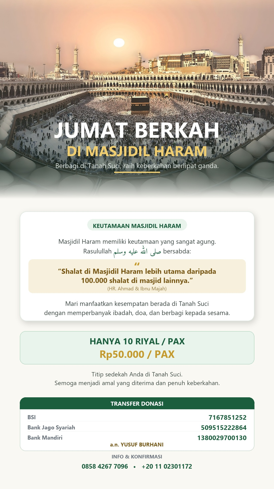

# Poster Generator — Yayasan Nur Mirah

Script Python untuk membuat poster dakwah/donasi secara otomatis.
Cocok untuk poster Jumat Berkah, sedekah, dan program kebaikan lainnya.

Semua teks, warna, dan rekening **bisa diubah** tanpa bikin ulang desain.



---

## 🚀 Cara Pakai

```bash
# 1. Install kebutuhan
pip install pillow arabic-reshaper python-bidi

# 2. Buat poster (pilih ukuran)
python scripts/buat_poster_jumat.py story   # 1080x1920 — WA/IG Story
python scripts/buat_poster_jumat.py feed    # 1080x1350 — Feed IG/FB
```

Hasil tersimpan di folder `hasil/` (PNG untuk kualitas, JPG untuk kirim WA).

---

## 📐 Ukuran yang Tersedia

| Nama | Ukuran | Rasio | Untuk |
|---|---|---|---|
| `story` | 1080×1920 | 9:16 | WhatsApp Story, IG Story, TikTok |
| `feed` | 1080×1350 | 4:5 | Feed Instagram & Facebook |

---

## ✏️ Cara Mengubah Isi Poster

Buka `scripts/buat_poster_jumat.py`, bagian **KONTEN** di paling atas:

```python
JUDUL_1 = "JUMAT BERKAH"
JUDUL_2 = "DI MASJIDIL HARAM"
SUBJUDUL = "Berbagi di Tanah Suci, raih keberkahan berlipat ganda."

NOMINAL_1 = "HANYA 10 RIYAL / PAX"
NOMINAL_2 = "Rp50.000 / PAX"

REKENING = [
    ("BSI", "7167851252"),
    ("Bank Jago Syariah", "509515222864"),
    ("Bank Mandiri", "1380029700130"),
]
ATAS_NAMA = "a.n. YUSUF BURHANI"
```

Ubah nilainya, lalu jalankan ulang script. Selesai.

### Mengubah warna

Ada di bagian **WARNA**:

```python
NAVY = (17, 51, 40)      # hijau tua (judul)
HIJAU = (27, 94, 62)     # hijau utama
EMAS = (198, 154, 42)    # aksen emas
KREM = (250, 248, 243)   # latar poster
```

Formatnya `(Merah, Hijau, Biru)` — masing-masing 0-255.

---

## ⚠️ Catatan Penting

### Tulisan Arab

PIL (library gambar Python) **tidak bisa** menulis Arab dengan benar sendiri —
hurufnya akan terpisah dan terbalik.

Karena itu script ini memakai `arabic-reshaper` + `python-bidi`:

```python
import arabic_reshaper
from bidi.algorithm import get_display

def arab(teks):
    return get_display(arabic_reshaper.reshape(teks))
```

**Selalu pakai fungsi `arab()`** untuk teks Arab. Jangan langsung `d.text()`.

### Posisi elemen

Posisi Y (vertikal) dibuat **menyesuaikan tinggi kanvas**. Kalau menambah ukuran
baru, pastikan hitungan total tidak melebihi tinggi kanvas, kalau tidak akan
terpotong.

Cara cek cepat: jalankan script, lalu periksa 3 baris terbawah gambar —
kalau ada teks di situ, berarti terpotong.

---

## 📁 Struktur

```
poster-generator/
├── scripts/
│   └── buat_poster_jumat.py    # script utama
├── aset/
│   ├── kabah.jpg               # foto latar
│   └── fonts/
│       └── Amiri-Regular.ttf   # font Arab
├── hasil/                      # output poster
└── README.md
```

---

## 📄 Lisensi & Sumber

- **Foto Ka'bah**: `aset/kabah.jpg`
- **Font Amiri**: SIL Open Font License (bebas dipakai komersial)
- Script ini bebas dipakai dan diubah untuk kebutuhan Yayasan.
